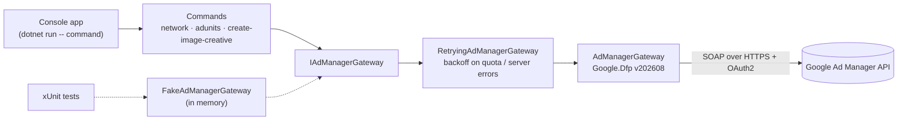

# gam-api-dotnet-quickstart

A small .NET 10 console app that calls the **Google Ad Manager SOAP API** with the official
.NET client library ([`Google.Dfp`](https://www.nuget.org/packages/Google.Dfp), API version **v202608**).

It is for developers who are new to the Ad Manager API and want a small, tested starting point.
It covers the things a first project needs:

- **Authentication** with a Google Cloud service account (OAuth2).
- **Three real API calls**: read the current network, list ad units, and create an image creative.
- **Paging** with a limit/offset loop, the way all Ad Manager "get by statement" calls work.
- **Retries** with exponential backoff for quota and server errors, with a cap and a log line per retry.
- **Safe writes**: creating a creative is a dry run unless you add `--execute`.
- **Testable design**: the client library sits behind a small interface, so all logic is unit tested without a network.

## How it works



1. `CommandLineParser` checks the arguments and reports every problem at once.
2. A command (for example `AdUnitsCommand`) does the work. It only knows `IAdManagerGateway`.
3. `RetryingAdManagerGateway` retries transient errors and then calls the real gateway.
4. `AdManagerGateway` is the **only** class that uses the Google library. It also turns library
   errors into this app's own error types, so the rest of the code never sees SOAP types.

```text
src/GamQuickstart/
  Program.cs                 Composition root: logging, HTTP client, real gateway
  CliApp.cs                  Runs a command, maps errors to messages and exit codes
  Cli/                       Argument parsing and validation, help text
  Commands/                  network, adunits, create-image-creative
  Gateway/                   IAdManagerGateway, real gateway, retry decorator, error translation
  Paging/                    Limit/offset paging loop
  Resilience/                Retry policy with exponential backoff
  Configuration/             Settings from environment variables or appsettings.json
  appsettings.example.json   Placeholders only. Copy it; never commit the copy.
tests/GamQuickstart.Tests/   xUnit tests with fakes (no network)
```

## Setup

You need the [.NET 10 SDK](https://dotnet.microsoft.com/download), a Google account, and a few minutes.

> **Never commit your key file or network code.** The `.gitignore` already ignores `appsettings.json`,
> `*service-account*.json`, `*-key.json`, `.env` and `secrets/`. Keep the key file outside the repository anyway.

### 1. Get an Ad Manager network

- **You already have a network:** use it. A test network is still a good idea for experiments.
- **You want a free test network:** a test network is a separate, empty environment for API development.
  You create one by calling `NetworkService.makeTestNetwork` once, for example with the official
  [MakeTestNetwork example](https://github.com/googleads/googleads-dotnet-lib/blob/main/examples/AdManager/CSharp/v202608/NetworkService/MakeTestNetwork.cs).
  Each Google account can have only one test network. Test networks cannot serve ads and hold at most
  10,000 objects per type. If you create it with a service account, also add an administrator user
  (`UserService.createUsers`) so that a person can open it in the Ad Manager UI.
  See [Test vs. Production](https://developers.google.com/ad-manager/api/environments).

Your **network code** is the number in the Ad Manager URL. In `https://admanager.google.com/1234#home`, it is `1234`.

### 2. Create a service account and a JSON key

1. Open the [Google Cloud console](https://console.cloud.google.com/) and create (or pick) a project.
2. Go to **IAM & Admin > Service accounts** and create a service account.
3. On the service account, open **Keys > Add key > Create new key > JSON**. A key file downloads.
4. Move the file to a private place **outside this repository**, for example:

   ```bash
   mkdir -p ~/.config/gam-quickstart
   mv ~/Downloads/<your-key>.json ~/.config/gam-quickstart/service-account-key.json
   chmod 600 ~/.config/gam-quickstart/service-account-key.json
   ```

Some Google Cloud organizations block key creation by policy. If so, use a personal project or ask your admin.

### 3. Turn on API access in Ad Manager

1. In Ad Manager, go to **Admin > Global settings**, turn **API access** on, and save.
2. Add the service account's email address as a **service account user** in the network
   (Admin > Access & authorization). Give it a role that can read inventory and manage creatives.

See [Authentication](https://developers.google.com/ad-manager/api/authentication) for the official steps.

### 4. Tell the app where things are

Use **environment variables** (they win over the file):

```bash
export GAM_NETWORK_CODE=12345678
export GAM_SERVICE_ACCOUNT_KEY_PATH="$HOME/.config/gam-quickstart/service-account-key.json"
# Optional: export GAM_APPLICATION_NAME=my-app
```

```powershell
# Windows PowerShell
$env:GAM_NETWORK_CODE = "12345678"
$env:GAM_SERVICE_ACCOUNT_KEY_PATH = "$HOME\.config\gam-quickstart\service-account-key.json"
```

Or use a **local settings file** that git ignores:

```bash
cp src/GamQuickstart/appsettings.example.json src/GamQuickstart/appsettings.json
# then edit NetworkCode and ServiceAccountKeyPath
```

If something is missing or wrong, the app tells you what to fix before it calls the API.

## Usage

All commands run from the repository root:

```bash
dotnet run --project src/GamQuickstart -- <command> [options]
dotnet run --project src/GamQuickstart -- help
```

### `network`: show the current network

Calls `NetworkService.getCurrentNetwork`.

```bash
dotnet run --project src/GamQuickstart -- network
```

Example output (the values are made up):

```text
Network code:  12345678
Display name:  My test network
Time zone:     Europe/Helsinki
Currency:      EUR
```

### `adunits`: list ad units page by page

Calls `InventoryService.getAdUnitsByStatement` with a `StatementBuilder` (`ORDER BY id ASC LIMIT n OFFSET m`)
and moves the offset forward until all results are read.

```bash
dotnet run --project src/GamQuickstart -- adunits              # all ad units, 500 per call
dotnet run --project src/GamQuickstart -- adunits --top 10     # stop after 10
dotnet run --project src/GamQuickstart -- adunits --page-size 2  # small pages, to watch the paging
```

Example with `--page-size 2`. The ad units are made up, and this run includes one quota error to show a retry.
Results go to stdout:

```text
ID             STATUS     NAME
21500001       ACTIVE     ca-pub-root
21500002       ACTIVE     homepage_top
21500003       INACTIVE   old_sidebar
Listed 3 of 3 ad unit(s) using 2 API call(s).
```

Log lines go to stderr (event IDs shortened):

```text
18:02:11 info: GamQuickstart.Commands.AdUnitsCommand[...] Page 1: asked for 2 ad units at offset 0, got 2 (3 in total).
18:02:11 warn: GamQuickstart.Resilience.RetryPolicy[...] InventoryService.getAdUnitsByStatement failed with a transient Quota error on attempt 1 of 5. Retrying in 2s. Error: QuotaError.EXCEEDED_QUOTA
18:02:13 info: GamQuickstart.Commands.AdUnitsCommand[...] Page 2: asked for 2 ad units at offset 2, got 1 (3 in total).
```

### `create-image-creative`: create an image creative (dry run by default)

Calls `CreativeService.createCreatives` with one `ImageCreative`. The image is downloaded from
`--image-url` and uploaded to Ad Manager. Without `--execute`, nothing is downloaded or sent,
and no credentials are needed.

```bash
dotnet run --project src/GamQuickstart -- create-image-creative \
  --advertiser-id 123 --image-url https://example.com/banner.png --width 300 --height 250
```

Real output of the command above:

```text
DRY RUN: nothing was sent to Ad Manager. Add --execute to create this creative.

Would create an ImageCreative:
  Name:              Quickstart image 300x250 2026-11-22 18:23:03 UTC
  Advertiser ID:     123
  Size:              300x250
  Image URL:         https://example.com/banner.png
  Click-through URL: (none: clicks do nothing)
```

To really create it, add `--execute`. Optional: `--name "My creative"` and `--click-through-url https://example.com/landing`.
`--advertiser-id` is the ID of a company of type *Advertiser* in your network.

### Exit codes

| Code | Meaning |
| ---- | ------- |
| 0 | Success |
| 1 | Configuration problem, API error, or retries ran out |
| 2 | Invalid arguments |

## Design notes

- **Retries.** These errors are retried: `QuotaError.EXCEEDED_QUOTA`, `ServerError.SERVER_ERROR`,
  `ServerError.SERVER_BUSY`, timeouts and connection failures. Up to 5 attempts, waiting 2s, 4s, 8s, 16s
  (each wait capped at 30s). Every retry is logged as a warning. Other errors (for example permission
  or validation errors) fail at once, because retrying cannot fix them.
- **No duplicate creatives.** Reads are retried on any transient error. `createCreatives` is retried
  **only** on a quota error, because then the API rejected the request. After a server error or a timeout,
  the creative may already exist, so a blind retry could create a second one.
- **Dry run first.** The write command prints its plan unless you pass `--execute`.
- **Clean output.** Results go to stdout, logs and errors go to stderr, so you can pipe the output.
- **Errors are checked early.** Settings and the key file are validated before the first API call,
  with messages that say what to fix.

## Tests and CI

```bash
dotnet build
dotnet test
```

The xUnit tests use an in-memory `FakeAdManagerGateway` and need no network or credentials. They cover:

- **Paging**: offsets and limits per call, `--top`, empty results, a source that reports a wrong total.
- **Retry**: backoff delays and the cap, giving up after the last attempt, logging, which errors are
  retried, and that creates are not retried after ambiguous errors.
- **Argument validation**: every option of every command, including error messages.
- **Dry run**: no gateway is created, nothing is sent, and the plan is printed.
- **Error translation**: real library exception objects (`AdManagerApiException` with `QuotaError`,
  `ServerError`, ...) built in memory and mapped to the app's error types.
- **Settings**: environment variables over `appsettings.json`, clear messages for missing values.

[`.github/workflows/ci.yml`](.github/workflows/ci.yml) runs restore, build and test on every push to
`main` and on every pull request. It needs no secrets and never calls the live API.

## Known limitations

- **Not tested against a live network in CI.** CI has no credentials on purpose, so it only runs the
  unit tests with fakes. Before publishing, I checked locally that the authentication code reaches Google's
  token endpoint (a throwaway key is rejected with `invalid_grant`, as expected). The three API calls
  themselves are only covered by the fakes in this repository.
- **Image creatives only**, one per run. The image is read fully into memory (max 10 MB).
- **Service account only.** The OAuth2 "web application" flow (acting for other users) is not included.
- **No filters on `adunits`.** It lists all ad units, ordered by ID.
- **Simple retry.** No random jitter and no settings on the command line; the values are in `RetryOptions`.
- **Cancellation (Ctrl+C) stops waiting**, but the library's SOAP methods take no cancellation token,
  so a request that is already sent is not stopped on the server.
- **One API version.** Ad Manager SOAP versions are retired after a while. To upgrade, change the
  `v202608` namespaces in `AdManagerGateway.cs` and `AdManagerErrorTranslator.cs`.
- The client library targets .NET Standard 2.0 and brings some older dependencies (for example WCF 4.5.x).

## What I would do next

- Add a `make-test-network` command to make first-time setup one step shorter.
- Add filters to `adunits` (for example `--status ACTIVE`) with PQL bind variables, not string concatenation.
- Add jitter to the backoff and make retry settings configurable.
- Support more creative types (for example third-party and HTML5 creatives).
- Add an opt-in integration test job that runs against a test network, with the key stored in a
  protected GitHub environment.
- Compare this with the newer [Ad Manager REST API (Beta)](https://developers.google.com/ad-manager/api/beta).

## Credits

Built on the official [googleads-dotnet-lib](https://github.com/googleads/googleads-dotnet-lib) (Apache-2.0),
published on NuGet as `Google.Dfp`.

The code in this repository is my own. I wrote it against the library's public API and did not copy the
official examples. If you want to compare, these official examples cover the same calls:
[GetCurrentNetwork](https://github.com/googleads/googleads-dotnet-lib/blob/main/examples/AdManager/CSharp/v202608/NetworkService/GetCurrentNetwork.cs),
[GetAllAdUnits](https://github.com/googleads/googleads-dotnet-lib/blob/main/examples/AdManager/CSharp/v202608/InventoryService/GetAllAdUnits.cs),
[CreateCreatives](https://github.com/googleads/googleads-dotnet-lib/blob/main/examples/AdManager/CSharp/v202608/CreativeService/CreateCreatives.cs).

Google Ad Manager is a trademark of Google LLC. This project is not affiliated with or endorsed by Google.

## License

[MIT](LICENSE) © 2026 Manisha Parwani
